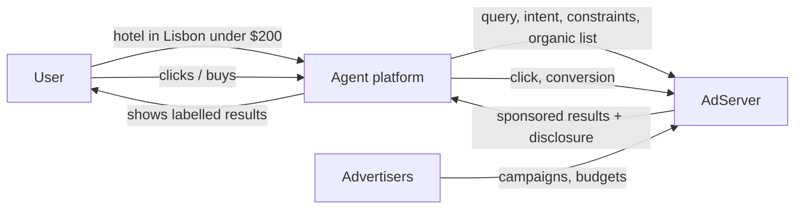

# Architecture — agent-ads

## 1. Scope
An ad server for agent recommendations that can't be bought into irrelevance.
**MVP:** campaigns (intents, keywords, attributes, bid, daily budget, quality), relevance gate,
hard-constraint filtering, generalised second-price auction over `bid × quality × relevance`,
mandatory disclosure labels, budget pacing, click and conversion attribution, reporting.
**Product:** publisher SDK / MCP tool for agent platforms, revenue share, policy engine, receipt-based conversion.

## 2. System context

## 3. Auction
1. **Eligibility:** budget remaining, intent match, hard constraints pass (`max_price`, `min_*`,
   exact attributes), relevance ≥ 0.35.
2. **Rank** by `bid × quality × relevance` for 2 slots.
3. **Price (GSP):** the minimum CPC to keep the rank, `next_rank_score / (quality × relevance) + 0.01`,
   floored at the reserve and capped at the bid.
4. **Disclosure:** every sponsored result carries `sponsored: true` and "Sponsored by X". Sponsored
   offers are de-duplicated out of the organic list.

## 4. Design decisions
- **Relevance gate before money.** This is the trust contract with users and platforms: no bid
  buys an irrelevant or constraint-violating placement. It's what distinguishes agent ads from
  prompt-injection-as-a-service.
- **GSP with quality.** It's well-understood economics, and advertisers pay for position, not their max bid.
- **Conversions must follow a click** on the same impression, which prevents attribution fraud.

## 5. Production architecture
A low-latency auction service (p99 under 30 ms, campaigns cached in memory, budgets in Redis with
atomic decrements), an event pipeline (impressions, clicks, conversions → ClickHouse), and an
advertiser console. Relevance gets an embedding model in the product, keeping the lexical gate as a floor.

## 6. Risks
Regulators (FTC endorsement guides) require clear disclosure, which is built in. Platforms may
resist, so revenue share and user-trust guarantees are part of the pitch.
